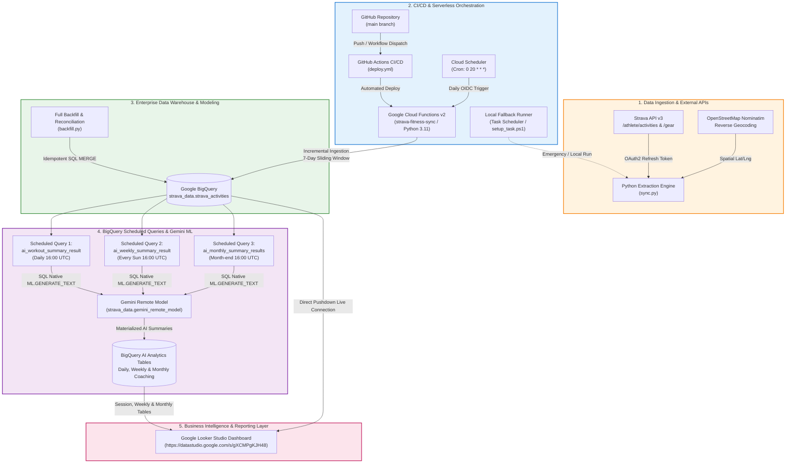

# 🏃‍♂️ Strava Fitness Analytics: Enterprise Cloud ELT & GenAI Pipeline

[](https://github.com/)
[](https://cloud.google.com/)
[](https://cloud.google.com/bigquery)
[-8E75C4?logo=google-gemini)](https://deepmind.google/technologies/gemini/)
[](https://datastudio.google.com/s/gXCMPgKJH48)
[](https://www.python.org/)

> 🔗 **Live Interactive Dashboard:** [Google Looker Studio Strava Dashboard](https://datastudio.google.com/s/gXCMPgKJH48)

---

## 📌 Executive Summary

Modern endurance athletes generate rich, high-frequency telemetry (GPS coordinates, cadence, heart rate, elevation gain, and equipment wear), yet native fitness applications isolate these data points in proprietary silos with limited analytical depth.

This repository implements an **end-to-end, automated Enterprise Data Pipeline** that:
1. **Extracts** raw athletic telemetry from the **Strava REST API** using automated OAuth 2.0 token rotation.
2. **Enriches** records with **spatial reverse-geocoding** (OpenStreetMap Nominatim) and **biomechanical feature engineering** (cadence estimation, stride frequency, pace formatting).
3. **Ingests** data incrementally into **Google Cloud BigQuery** with zero-loss deduplication and idempotent reconciliation.
4. **Synthesizes Multi-Granular GenAI Coaching Reports** directly in SQL using **Google Gemini 1.5 via BigQuery ML (`ML.GENERATE_TEXT`)** orchestrated via **3 automated BigQuery Scheduled Queries** (Daily Session, Weekly Microcycle, and Monthly Mesocycle summaries).
5. **Orchestrates** deployment via **GitHub Actions CI/CD** and execution via **Google Cloud Scheduler**.
6. **Visualizes** longitudinal trends, shoe depreciation, training intensity distributions, and AI coaching narratives in an executive **Google Looker Studio** dashboard.

---

## 🏗️ Architecture Flowchart



---

## 📑 Chapter Directory

- [Chapter 1: Pipeline Architecture & High-Level System Design](#chapter-1-pipeline-architecture--high-level-system-design)
- [Chapter 2: Data Extraction & API Ingestion Layer](#chapter-2-data-extraction--api-ingestion-layer)
- [Chapter 3: Analytics Engineering, Geocoding & Feature Engineering](#chapter-3-analytics-engineering-geocoding--feature-engineering)
- [Chapter 4: Data Warehousing & Schema Design in BigQuery](#chapter-4-data-warehousing--schema-design-in-bigquery)
- [Chapter 5: In-Warehouse GenAI Analytics (BigQuery ML & 3 Scheduled Queries)](#chapter-5-in-warehouse-genai-analytics-bigquery-ml--3-scheduled-queries)
- [Chapter 6: CI/CD Pipeline & Serverless Orchestration](#chapter-6-cicd-pipeline--serverless-orchestration)
- [Chapter 7: Business Intelligence & Google Looker Studio Dashboard](#chapter-7-business-intelligence--google-looker-studio-dashboard)
- [Chapter 8: Data Governance, Security & Idempotency](#chapter-8-data-governance-security--idempotency)
- [Chapter 9: Career & Portfolio Highlights (Data Engineer / Analytics Engineer)](#chapter-9-career--portfolio-highlights)

---

## Chapter 1: Pipeline Architecture & High-Level System Design

### 1.1 Problem Statement
Athletic telemetry captured across smart wearables presents distinct data engineering hurdles:
1. **Volatile OAuth Lifecycle**: Strava access tokens expire every 6 hours, requiring robust automated token rotation.
2. **Rate Limits & Throttle Risks**: API calls are strictly capped (100 requests per 15-minute window; 1,000 per day), prohibiting naive full-table scans.
3. **Multi-Scale Analytical Needs**: Athletes require micro feedback (individual workout breakdown), meso feedback (weekly volume and recovery), and macro feedback (monthly shoe wear and aerobic adaptations).
4. **Actionability & Latency**: Running LLM inference outside the warehouse introduces data privacy concerns and slows dashboard rendering. Pre-computing AI summaries inside BigQuery via **Scheduled Queries** resolves both.

### 1.2 Architectural Decisions & Trade-Offs

| Component | Technology Selected | Alternatives Considered | Engineering Trade-off & Rationale |
| :--- | :--- | :--- | :--- |
| **Ingestion Engine** | Google Cloud Functions Gen 2 (Python 3.11) | Cloud Run, AWS Lambda, VM Cron | Zero idle cost; sub-second cold starts; native IAM integration. |
| **Orchestration** | Google Cloud Scheduler + GitHub Actions | Apache Airflow / Cloud Composer | Serverless cron triggers eliminate the $300+/month infrastructure cost of an idle Airflow cluster. |
| **Data Warehouse** | Google Cloud BigQuery | Snowflake, PostgreSQL / Cloud SQL | Columnar analytical store with built-in remote GenAI connections via BigQuery ML. |
| **GenAI Modeling** | BigQuery ML (`ML.GENERATE_TEXT` + Gemini 1.5) | OpenAI API via Python, LangChain | Zero data egress; compliance with enterprise governance; analysts can prompt the LLM directly via SQL. |
| **AI Scheduling** | BigQuery Scheduled Queries (Daily, Weekly, Monthly) | Cloud Composer DAGs, Cloud Tasks | Natively automated within BigQuery; pre-computes LLM summaries so Looker Studio loads instantly. |
| **BI Presentation** | Google Looker Studio | Tableau, Power BI, Streamlit | Native live BigQuery connector with direct pushdown querying, zero licensing cost, and shareable web links. |

---

## Chapter 2: Data Extraction & API Ingestion Layer

The ingestion subsystem (`sync.py` & `main.py`) operates as a lightweight, resilient extract-load process.

```
       ┌────────────────────────┐
       │ STRAVA REFRESH TOKEN   │
       └───────────┬────────────┘
                   │ POST https://www.strava.com/oauth/token
                   ▼
       ┌────────────────────────┐
       │ Ephemeral Bearer Token │ (Valid for 6 hours)
       └───────────┬────────────┘
                   │
         ┌─────────┴─────────┐
         ▼                   ▼
  /athlete/activities     /gear/{gear_id}
  (7-day rolling window)  (Cached Shoe Metadata)
```

### 2.1 Automated OAuth 2.0 Token Refresh Flow
Strava employs a short-lived bearer token architecture. The synchronization worker securely authenticates using long-lived credentials stored in environment secrets:

```python
def get_strava_access_token():
    url = "https://www.strava.com/oauth/token"
    payload = {
        "client_id": STRAVA_CLIENT_ID,
        "client_secret": STRAVA_CLIENT_SECRET,
        "refresh_token": STRAVA_REFRESH_TOKEN,
        "grant_type": "refresh_token"
    }
    response = requests.post(url, data=payload)
    response.raise_for_status()
    return response.json()["access_token"]
```

### 2.2 Incremental Sliding-Window Ingestion
To maintain high performance and stay well within API quotas, daily cron syncs fetch only activities from a **7-day sliding window** (`days=7`):
- Activities are paginated with `per_page=200`.
- Existing records are verified against BigQuery: `SELECT Strava_ID FROM strava_activities`.
- Only records where `activity.id NOT IN existing_ids` are queued for insertion.
- The 7-day lookback window automatically catches late edits, manual entries, or delayed device syncs without triggering expensive full-table refreshes.

### 2.3 Rate Limit Resilience & Historical Backfilling
For initial deployment or full database rebuilds, `backfill.py` implements a rate-limit-aware extraction mechanism:
- Monitors HTTP `429 Too Many Requests` responses.
- Implements exponential backoff and automatic 60-second sleep cycles.
- Pre-caches existing geographic coordinate lookups to minimize external geocoding requests.

---

## Chapter 3: Analytics Engineering, Geocoding & Feature Engineering

Raw data ingested from mobile applications is rarely analytics-ready. The ingestion pipeline executes immediate transformations and feature derivation:

### 3.1 Spatial Enrichment via Reverse Geocoding
Strava provides raw coordinates (`[start_lat, start_lng]`). The pipeline integrates with the **OpenStreetMap Nominatim API** to resolve coordinates into human-readable administrative hierarchies:
- **Attributes Extracted**: `City_District`, `Village`, `Town`, `City`, `Municipality`, `State`, `Country`.
- **In-Memory Caching (`GEO_CACHE`)**: Coordinates are rounded to 3 decimal places (~110m precision) and memoized. Identical workout starting points (e.g., home or regular trail heads) avoid repeated API requests, staying within free-tier usage policies.

### 3.2 Biomechanical Metrics & Cadence Estimation
For workouts logged without dedicated foot pods or heart rate straps:
1. **Pace Formatting**: Converted from decimal minutes into standardized `MM:SS/km` strings.
2. **Step & Cadence Imputation**:
   - When hardware cadence is present: $\text{Total Steps} = (\text{Cadence} \times 2) \times \text{Duration}_{\text{min}}$ (using moving time to prevent false steps during pauses).
   - When cadence is missing for Runs: Non-linear regression based on speed:
     $$\text{SPM}_{\text{est}} = \max(145.0, \min(180.0, 140.0 + 2.3 \times \text{Speed}_{\text{km/h}}))$$
   - When cadence is missing for Walks/Hikes: Constant estimation factor ($1,300 \text{ steps/km}$).

### 3.3 Temporal Dimensions for BI Sorting
To avoid lexicographical sorting bugs in BI tools (e.g., "Friday" sorting before "Monday"):
- `Day_Num`: ISO weekday representation (`01` = Monday, `07` = Sunday).
- `Month_Num`: Zero-padded integer (`01` to `12`).
- `Week_Num`: ISO week number (`01` to `53`).
- `Start_Time` & `End_Time`: Precise clock times computed from elapsed workout duration.

---

## Chapter 4: Data Warehousing & Schema Design in BigQuery

### 4.1 Schema Definition (`strava_data.strava_activities`)

The primary analytical warehouse table is hosted on Google Cloud BigQuery (`strava-sync-505308.strava_data.strava_activities`).

| Field Name | Type | Mode | Description |
| :--- | :--- | :--- | :--- |
| `Strava_ID` | `INT64` | REQUIRED | Unique activity identifier (Primary Key) |
| `Name` | `STRING` | NULLABLE | Athlete workout title |
| `Date` | `DATE` | REQUIRED | Workout execution date (`YYYY-MM-DD`) |
| `Year_Name` | `STRING` | NULLABLE | 4-digit year string |
| `Month_Name` | `STRING` | NULLABLE | Full month name (e.g., "August") |
| `Month_Num` | `STRING` | NULLABLE | Zero-padded month index (`01` - `12`) |
| `Day_Name` | `STRING` | NULLABLE | Day of week (e.g., "Sunday") |
| `Day_Num` | `STRING` | NULLABLE | ISO weekday order (`01` to `07`) |
| `Week_Num` | `STRING` | NULLABLE | ISO calendar week number |
| `Type` | `STRING` | REQUIRED | Activity classification (`Run`, `Walk`, `Ride`, `Workout`) |
| `Distance_km` | `FLOAT64` | NULLABLE | Total distance covered in kilometers |
| `Duration_min` | `FLOAT64` | NULLABLE | Active moving time in minutes |
| `Elapsed_Time_min` | `FLOAT64` | NULLABLE | Gross elapsed time including rest breaks |
| `Elevation_m` | `FLOAT64` | NULLABLE | Total cumulative elevation gain in meters |
| `Pace` | `STRING` | NULLABLE | Standardized pace format (`MM:SS/km`) |
| `Gear` | `STRING` | NULLABLE | Specific shoe or equipment used |
| `Start_Time` | `STRING` | NULLABLE | Activity start timestamp (`HH:MM:SS`) |
| `End_Time` | `STRING` | NULLABLE | Activity end timestamp (`HH:MM:SS`) |
| `Calories` | `FLOAT64` | NULLABLE | Estimated metabolic energy expenditure |
| `Avg_HR` | `FLOAT64` | NULLABLE | Average heart rate in beats per minute |
| `Cadence` | `FLOAT64` | NULLABLE | Average single-leg strides per minute |
| `Total_Steps` | `INT64` | NULLABLE | Total calculated or measured foot strikes |
| `Avg_Strides_Min` | `INT64` | NULLABLE | Average strides per minute |
| `Avg_Steps_Min` | `INT64` | NULLABLE | Average steps per minute (both legs) |
| `Start_Lat` | `FLOAT64` | NULLABLE | Starting GPS latitude |
| `Start_Lng` | `FLOAT64` | NULLABLE | Starting GPS longitude |
| `City_District` | `STRING` | NULLABLE | Administrative sub-district |
| `Village` | `STRING` | NULLABLE | Village or neighborhood classification |
| `Town` | `STRING` | NULLABLE | Municipal town classification |
| `City` | `STRING` | NULLABLE | Metropolitan city jurisdiction |
| `Municipality` | `STRING` | NULLABLE | Local government unit |
| `State` | `STRING` | NULLABLE | State / Province boundary |
| `Country` | `STRING` | NULLABLE | Sovereign nation state |

### 4.2 Idempotency & Deduplication Strategy
To guarantee data integrity across pipeline retries and backfills, the pipeline implements a two-tiered deduplication strategy:
1. **Incremental Sync**: BigQuery set filtering prevents double-insertion of activities already present in the destination table.
2. **Backfill Reconciliation (`backfill.py`)**: Uses a temporary staging table (`strava_activities_temp`) and an atomic SQL `MERGE` statement:

```sql
MERGE `strava_data.strava_activities` T
USING `strava_data.strava_activities_temp` S
ON T.Strava_ID = S.Strava_ID
WHEN MATCHED THEN
  UPDATE SET
    T.Name = S.Name,
    T.Date = S.Date,
    T.Distance_km = S.Distance_km,
    T.Duration_min = S.Duration_min,
    T.Elevation_m = S.Elevation_m,
    T.Pace = S.Pace,
    T.Gear = S.Gear,
    T.Avg_HR = S.Avg_HR,
    T.Total_Steps = S.Total_Steps
WHEN NOT MATCHED THEN
  INSERT ROW;
```

---

## Chapter 5: In-Warehouse GenAI Analytics (BigQuery ML & 3 Scheduled Queries)

Instead of relying on external Python services or fragile API orchestration to call third-party LLMs, this architecture implements **BigQuery ML with Vertex AI Remote Models**.

The system automates continuous AI inference using **3 BigQuery Scheduled Queries** configured directly within Google Cloud BigQuery:

```
┌────────────────────────────────────────────────────────────────────────┐
│                        BIGQUERY SCHEDULED QUERIES                      │
├──────────────────────────────┬────────────────────────┬────────────────┤
│ DISPLAY NAME                 │ SCHEDULE (UTC)         │ REGION         │
├──────────────────────────────┼────────────────────────┼────────────────┤
│ ai_workout_summary_result    │ every day 16:00        │ us (multi-reg) │
│ ai_weekly_summary_result     │ every sun 16:00        │ us (multi-reg) │
│ ai_monthly_summary_results   │ 28,29,30,31 of mo 16:00│ us (multi-reg) │
└──────────────────────────────┴────────────────────────┴────────────────┘
                                  │
                                  ▼
      ┌────────────────────────────────────────────────────────┐
      │ ML.GENERATE_TEXT(MODEL strava_data.gemini_remote_model)│
      └───────────────────────────┬────────────────────────────┘
                                  │
                                  ▼
      ┌────────────────────────────────────────────────────────┐
      │ Materialized Columns & Tables for Looker Studio        │
      │ • Session Summary (Workout Level)                      │
      │ • Weekly Summary (Microcycle Level)                    │
      │ • Monthly Summary (Mesocycle Level)                    │
      └────────────────────────────────────────────────────────┘
```

### 5.1 Remote Gemini Model Configuration
BigQuery connects to Vertex AI using a Google Cloud Resource Connection:

```sql
CREATE OR REPLACE MODEL `strava_data.gemini_remote_model`
REMOTE WITH CONNECTION `projects/strava-sync-505308/locations/us/connections/vertex-ai-connection`
OPTIONS (ENDPOINT = 'gemini-1.5-flash');
```

---

### 5.2 The 3 BigQuery Scheduled Queries

#### 1. Daily Session Summary (`ai_workout_summary_result`)
* **Schedule:** `every day 16:00` UTC (Midnight 12:00:00 AM UTC+8)
* **Granularity:** Individual Workout Level
* **Objective:** Runs every night after daily runs sync. Evaluates workout intensity, pace consistency, cadence, and heart rate efficiency to generate an immediate qualitative coaching review.
* **Destination:** Persisted into the session records and surfaced in the Looker Studio **Session Summary** table under the `Summary` column (e.g. *"Alright, let's break down this afternoon run..."*).

```sql
-- Scheduled Daily at 16:00 UTC
SELECT
  Strava_ID,
  Date,
  Name,
  Type,
  Distance_km,
  Cadence,
  Pace,
  Avg_HR,
  ml_generate_text_llm_result AS workout_summary
FROM ML.GENERATE_TEXT(
  MODEL `strava_data.gemini_remote_model`,
  (
    SELECT
      Strava_ID, Date, Name, Type, Distance_km, Cadence, Pace, Avg_HR,
      CONCAT(
        'You are an expert running coach. Analyze this individual workout: ',
        'Name: ', Name, ', Type: ', Type, ', Date: ', CAST(Date AS STRING),
        ', Distance: ', CAST(Distance_km AS STRING), ' km, Pace: ', Pace,
        ', Cadence: ', IFNULL(CAST(Cadence AS STRING), 'N/A'), ' spm',
        ', Heart Rate: ', IFNULL(CAST(Avg_HR AS STRING), 'N/A'), ' bpm. ',
        'Provide a concise 1-2 sentence coaching breakdown starting with "Alright, let\'s break down..." evaluating pacing, form, and aerobic load.'
      ) AS prompt
    FROM `strava_data.strava_activities`
    WHERE Date >= DATE_SUB(CURRENT_DATE(), INTERVAL 2 DAY)
  ),
  STRUCT(TRUE AS flatten_json_output, 150 AS max_output_tokens, 0.2 AS temperature)
);
```

---

#### 2. Weekly Training Summary (`ai_weekly_summary_result`)
* **Schedule:** `every sun 16:00` UTC (Sunday midnight / Monday 12:00:00 AM UTC+8)
* **Granularity:** Weekly Microcycle Block
* **Objective:** Aggregates weekly mileage, workout session frequency, cadence averages, and shoes used. Synthesizes a coaching review of weekly volume progression and recovery guidance.
* **Destination:** Feeds into the Looker Studio **Weekly Summary** table.

```sql
-- Scheduled Every Sunday at 16:00 UTC
SELECT
  Week_Number,
  Week_Start,
  Weekly_Distance_km,
  Total_Workouts,
  Avg_Weekly_Pace,
  Avg_Weekly_HR,
  Shoes_Used,
  ml_generate_text_llm_result AS weekly_ai_summary
FROM ML.GENERATE_TEXT(
  MODEL `strava_data.gemini_remote_model`,
  (
    SELECT
      Week_Number, Week_Start, Weekly_Distance_km, Total_Workouts, Avg_Weekly_Pace, Avg_Weekly_HR, Shoes_Used,
      CONCAT(
        'Act as an elite running coach. Analyze weekly training microcycle for ', Week_Number,
        ' starting ', CAST(Week_Start AS STRING), ': Total Distance: ', CAST(Weekly_Distance_km AS STRING), ' km',
        ', Sessions: ', CAST(Total_Workouts AS STRING), ', Avg Pace: ', Avg_Weekly_Pace,
        ', Avg HR: ', IFNULL(CAST(Avg_Weekly_HR AS STRING), 'N/A'), ' bpm, Shoes: ', IFNULL(Shoes_Used, 'None'),
        '. Give a 2-3 sentence coaching critique on consistency, pace management, and recovery advice.'
      ) AS prompt
    FROM (
      SELECT
        CONCAT('Week ', LPAD(CAST(Week_Num AS STRING), 2, '0')) AS Week_Number,
        DATE_TRUNC(Date, WEEK(MONDAY)) AS Week_Start,
        ROUND(SUM(Distance_km), 2) AS Weekly_Distance_km,
        COUNT(*) AS Total_Workouts,
        FORMAT('%02d:%02d/km',
          CAST(FLOOR(AVG(CASE WHEN Type = 'Run' AND Distance_km > 0 THEN Duration_min / Distance_km END)) AS INT64),
          CAST(ROUND((AVG(CASE WHEN Type = 'Run' AND Distance_km > 0 THEN Duration_min / Distance_km END) - FLOOR(AVG(CASE WHEN Type = 'Run' AND Distance_km > 0 THEN Duration_min / Distance_km END))) * 60) AS INT64)
        ) AS Avg_Weekly_Pace,
        ROUND(AVG(CASE WHEN Avg_HR > 0 THEN Avg_HR END), 1) AS Avg_Weekly_HR,
        STRING_AGG(DISTINCT Gear, ', ') AS Shoes_Used
      FROM `strava_data.strava_activities`
      GROUP BY 1, 2
    )
  ),
  STRUCT(TRUE AS flatten_json_output, 200 AS max_output_tokens, 0.25 AS temperature)
);
```

---

#### 3. Monthly Mesocycle Summary (`ai_monthly_summary_results`)
* **Schedule:** `28,29,30,31 of month 16:00` UTC (Month-end midnight UTC+8)
* **Granularity:** Monthly Mesocycle
* **Objective:** Assesses monthly volume accumulation, periodization shifts (e.g. Base building vs. Marathon peak), cumulative footwear wear, and cardiovascular adaptations.
* **Destination:** Feeds into the Looker Studio **Monthly Summary** table.

```sql
-- Scheduled at Month-End at 16:00 UTC
SELECT
  Month_Name,
  Year_Name,
  Monthly_Distance_km,
  Total_Sessions,
  Avg_Monthly_Pace,
  Avg_Monthly_HR,
  ml_generate_text_llm_result AS monthly_ai_summary
FROM ML.GENERATE_TEXT(
  MODEL `strava_data.gemini_remote_model`,
  (
    SELECT
      Month_Name, Year_Name, Monthly_Distance_km, Total_Sessions, Avg_Monthly_Pace, Avg_Monthly_HR,
      CONCAT(
        'You are an exercise physiologist. Evaluate the athlete monthly mesocycle for ', Month_Name, ' ', Year_Name,
        ': Total Volume: ', CAST(Monthly_Distance_km AS STRING), ' km across ', CAST(Total_Sessions AS STRING), ' workouts',
        ', Avg Pace: ', Avg_Monthly_Pace, ', Avg HR: ', IFNULL(CAST(Avg_Monthly_HR AS STRING), 'N/A'), ' bpm.',
        ' Provide a concise 2-sentence sports-science summary on monthly training volume, intensity distribution, and aerobic adaptations.'
      ) AS prompt
    FROM (
      SELECT
        Month_Name, Year_Name,
        ROUND(SUM(Distance_km), 2) AS Monthly_Distance_km,
        COUNT(*) AS Total_Sessions,
        FORMAT('%02d:%02d/km',
          CAST(FLOOR(AVG(CASE WHEN Type = 'Run' AND Distance_km > 0 THEN Duration_min / Distance_km END)) AS INT64),
          CAST(ROUND((AVG(CASE WHEN Type = 'Run' AND Distance_km > 0 THEN Duration_min / Distance_km END) - FLOOR(AVG(CASE WHEN Type = 'Run' AND Distance_km > 0 THEN Duration_min / Distance_km END))) * 60) AS INT64)
        ) AS Avg_Monthly_Pace,
        ROUND(AVG(CASE WHEN Avg_HR > 0 THEN Avg_HR END), 1) AS Avg_Monthly_HR
      FROM `strava_data.strava_activities`
      GROUP BY 1, 2
    )
  ),
  STRUCT(TRUE AS flatten_json_output, 250 AS max_output_tokens, 0.25 AS temperature)
);
```

### 5.3 Why Scheduled Queries for In-Warehouse GenAI?
1. **Zero Dashboard Latency**: LLM text generation can take 2–5 seconds per row. Pre-computing via Scheduled Queries materializes results ahead of time, ensuring Looker Studio queries execute instantaneously.
2. **Cost Optimization**: Queries only execute on a defined schedule (daily, weekly, monthly) rather than recalculating on every dashboard viewer interaction.
3. **Enterprise Governance**: Prompts, schemas, and LLM hyperparameters remain version-controlled inside the data warehouse.

---

## Chapter 6: CI/CD Pipeline & Serverless Orchestration

### 6.1 GitHub Actions Deployment (`.github/workflows/deploy.yml`)
The project utilizes automated CI/CD to eliminate manual deployment overhead:
- **Trigger**: Every push to the `main` branch or manual `workflow_dispatch`.
- **Authentication**: Keyless identity federation via `google-github-actions/auth@v2` using repository secrets (`GCP_SA_KEY`).
- **Target**: Google Cloud Functions Gen 2 (running on Cloud Run infrastructure).

```yaml
name: Deploy to Google Cloud Functions

on:
  push:
    branches: [ main ]
  workflow_dispatch:

jobs:
  deploy:
    runs-on: ubuntu-latest
    steps:
      - name: Checkout repository
        uses: actions/checkout@v4

      - name: Authenticate to Google Cloud
        uses: google-github-actions/auth@v2
        with:
          credentials_json: ${{ secrets.GCP_SA_KEY }}

      - name: Set up Cloud SDK
        uses: google-github-actions/setup-gcloud@v2

      - name: Deploy Cloud Function
        run: |
          gcloud functions deploy strava-fitness-sync \
            --gen2 \
            --runtime=python311 \
            --region=${{ secrets.GCP_REGION || 'asia-southeast1' }} \
            --source=. \
            --entry-point=main \
            --trigger-http \
            --no-allow-unauthenticated \
            --timeout=300s \
            --memory=512Mi \
            --set-env-vars=GCP_PROJECT_ID=${{ secrets.GCP_PROJECT_ID }},STRAVA_CLIENT_ID=${{ secrets.STRAVA_CLIENT_ID }},STRAVA_CLIENT_SECRET=${{ secrets.STRAVA_CLIENT_SECRET }},STRAVA_REFRESH_TOKEN=${{ secrets.STRAVA_REFRESH_TOKEN }}
```

### 6.2 Automated Scheduling via Google Cloud Scheduler
Daily ingestion is orchestrated using a serverless cron job:
- **Job Name**: `daily-strava-sync`
- **Schedule**: `0 20 * * *` (Daily at 8:00 PM local time)
- **Target**: Cloud Function HTTP Endpoint
- **Security**: OIDC Token authentication via dedicated Service Account (`strava-bigquery-loader@strava-sync-505308.iam.gserviceaccount.com`), blocking unauthenticated public internet traffic.

### 6.3 Local Hybrid Fallback Runner (`setup_task.ps1` & `run_sync.bat`)
To ensure pipeline resilience during cloud outages or local development:
- A Windows Task Scheduler task is configured via PowerShell (`setup_task.ps1`) to run `run_sync.bat` daily at 8:00 PM.
- Appends execution output and exit codes directly to `sync.log`.

---

## Chapter 7: Business Intelligence & Google Looker Studio Dashboard

The production analytics layer is delivered through an interactive executive dashboard deployed on **Google Looker Studio (formerly Google Data Studio)**, directly connected to BigQuery with live pushdown queries.

> 🔗 **Live Report URL:** [https://datastudio.google.com/s/gXCMPgKJH48](https://datastudio.google.com/s/gXCMPgKJH48)

```
┌────────────────────────────────────────────────────────────────────────────────────────┐
│ 🟠 STRAVA DASHBOARD   [Kilometers: 356]  [Sessions: 161]  [Cadence: 163]  [HR: 110]   │
│                       (📈 Sparkline)     (📈 Sparkline)   (📈 Sparkline)  (📈 Sparkline)│
├────────────────────────────────────────────────────────────────────────────────────────┤
│ FILTERS: [Run Type ▼ (All/Easy/Tempo/Long/Interval)]  [Select date range ▼]            │
├─────────────────────────────────────────────┬──────────────────────────┬───────────────┤
│ 📊 MONTHLY MILEAGE COMBO CHART              │ 👟 SHOE MILEAGE [KM]     │ 🏃 RUN TYPE   │
│ • Blue Bars: Kilometers (Monthly volume)    │ • Dynafish Xiaonian: 171 │ • Easy: 238 km│
│ • Orange Line: Sessions (Workout frequency) │ • Anta PG7 2.5: 56 km    │ • Tempo: 59 km│
│   (Feb: 1.6km | Mar: 17.5km | May: 41.2km   │ • Qiaodan Leili: 55 km   │ • Long: 53 km │
│    Jun: 68.9km | Jul: 74.1km | Aug: 59.6km  │ • Li-ning Feidian: 45 km │ • Interval:   │
│    Sep: 58.5km | Oct: 31.1km)               │ • Xtep 2000KM: 29 km     │   Speedwork   │
├─────────────────────────────────────────────┴──────────────────────────┴───────────────┤
│ 📋 SESSION SUMMARY (161 Activities with In-Warehouse Gemini AI Coaching)               │
│ • Day | Name | Type | Distance | Cadence | Pace | HR | AI Workout Summary              │
│ • Oct 11: Afternoon Run | Easy | 4.01 km | 161 spm | 08:34/km | 166 bpm | "Alright..."│
│ • Oct 04: Project Half M... | Long | 20.85 km | 160 spm | 07:03/km | 172 bpm | "..."   │
├─────────────────────────────────────────────┬──────────────────────────────────────────┤
│ 📅 MONTHLY SUMMARY (10 Months Mesocycle)    │ 📆 WEEKLY SUMMARY (30 Weeks Microcycle)  │
│ • Month | Dist | Cadence | Pace | Sessions  │ • Week | Dist | Cadence | Pace | Sessions│
│ • Oct 2026: 31.09km | 161spm | 06:42/km | 4 │ • W41: 6.72km | 160spm | 07:03/km | 2    │
│ • Sep 2026: 58.49km | 163spm | 06:13/km | 19│ • W40: 24.37km | 163spm | 06:20/km | 2   │
│ • Aug 2026: 59.55km | 164spm | 05:58/km | 39│ • W39: 12.14km | 165spm | 06:05/km | 4   │
│ • Jul 2026: 74.14km | 162spm | 06:24/km | 21│ • W38: 13.36km | 163spm | 05:60/km | 4   │
│ (Each row includes Gemini monthly summary!) │ (Each row includes Gemini weekly summary!)│
└─────────────────────────────────────────────┴──────────────────────────────────────────┘
```

---

### 7.1 Key Dashboard Components

#### 1. Executive Metric Scorecards (with Temporal Sparklines)
Located across the dashboard header to deliver immediate high-level athletic benchmarks:
* **Total Kilometers:** `356 km` (with trend sparkline tracking cumulative distance)
* **Total Sessions:** `161 workouts` (with frequency sparkline)
* **Average Cadence:** `163 spm` (with running form consistency sparkline)
* **Average Heart Rate:** `110 bpm` (with cardiovascular intensity sparkline)

#### 2. Interactive Global Dimension Filters
* **Run Type Filter:** Dropdown allowing cross-filtering across `Easy`, `Tempo`, `Long`, and `Interval` workouts. Selecting a type updates all charts and summary tables simultaneously.
* **Date Range Picker:** Calendar control for filtering by custom training blocks or specific race preparation seasons.

#### 3. Monthly Mileage Dual-Axis Combo Chart
Combines distance and frequency to visualize training periodization over time:
* **Primary Y-Axis (Blue Bars):** Total distance in kilometers per month (peaks in July at `74.1 km`, August at `59.6 km`, and September at `58.5 km`).
* **Secondary Y-Axis (Orange Line with Markers):** Total active sessions per month (e.g. 39 sessions in August, 37 sessions in May).
* **Analytical Value:** Reveals training consistency, volume build-up, and recovery tapers.

#### 4. Shoe Mileage [KM] Donut Chart (Wear & Depreciation)
Visualizes footwear rotation to track midsole degradation and prevent injury:
* **Dynafish Xiaonian:** `171 km` (Primary daily trainer)
* **Anta PG7 2.5:** `56 km` (Retired benchmark shoe)
* **Qiaodan Feiying / Leili:** `55 km` (Lightweight tempo shoe)
* **Li-ning Feidian 6 Elite:** `45 km` (Carbon-plated race day shoe)
* **Xtep 2000KM 5 Pro:** `29 km` (High-durability mileage shoe)

#### 5. Run Type [KM] Donut Chart (80/20 Intensity Polarized Model)
Analyzes distance distribution across athletic workout categories:
* **Easy Runs:** `238 km` (~67% of total volume — foundational aerobic base building)
* **Tempo Runs:** `59 km` (~17% — lactate threshold development)
* **Long Runs:** `53 km` (~15% — muscular endurance & glycogen depletion adaptation)
* **Interval Workouts:** Speedwork & VO2 max stimulus

---

### 7.2 Tri-Level Synchronized Summaries with Embedded Gemini GenAI

The core differentiator of this dashboard is the seamless embedding of **Google Gemini AI summaries** across three synchronized tables:

1. **Session Summary Table (Workout Level):**
   * Displays individual workouts with columns `Day`, `Name`, `Type`, `Distance`, `Cadence`, `Pace`, `HR`, and `Summary`.
   * The `Summary` column renders the text generated by the daily `ai_workout_summary_result` scheduled query, providing instantaneous feedback on pacing and form for every individual workout.
2. **Weekly Summary Table (Microcycle Level):**
   * Columns: `Week`, `Distance`, `Cadence`, `Pace`, `Sessions`, `HR`, `Summary`.
   * Shows weekly rollups (e.g., Week 41, Week 40, Week 39) with Gemini's weekly coaching notes evaluating weekly consistency and recovery.
3. **Monthly Summary Table (Mesocycle Level):**
   * Columns: `Month`, `Distance`, `Cadence`, `Pace`, `Sessions`, `HR`, `Summary`.
   * Highlights monthly macrocycle adaptations, periodization trends, and cumulative aerobic fitness progression.

---

## Chapter 8: Data Governance, Security & Idempotency

### 8.1 Least-Privilege IAM Roles
The dedicated Service Account uses strictly scoped IAM roles:
- `roles/cloudfunctions.admin`: Function deployment and lifecycle management.
- `roles/run.admin`: Cloud Run management (underlying engine for Gen 2 functions).
- `roles/bigquery.dataEditor`: Table creation, data insertion, and updates.
- `roles/bigquery.jobUser`: Running query jobs and BigQuery ML invocations.
- `roles/iam.serviceAccountUser`: Impersonation during automated deployments.

### 8.2 Secret Management & Git Hygiene
- Zero secrets committed: `.env` and `credentials.json` are excluded via `.gitignore` and `.gcloudignore`.
- CI/CD secrets injected dynamically at deployment time via GitHub Actions Secrets.
- Strava client secrets and refresh tokens are injected as runtime environment variables directly into the Cloud Function container.

---

## Chapter 9: Career & Portfolio Highlights

This project demonstrates core competencies across multiple modern data roles:

### 🛠️ For Data Engineering Roles
- **Automated ELT Pipelines**: Built an API-to-Cloud warehouse pipeline handling token rotation, rate limits, pagination, and backfilling.
- **Serverless Architecture**: Cloud Functions Gen 2, Cloud Scheduler, and BigQuery eliminating infrastructure maintenance costs.
- **Data Integrity & Idempotency**: Implemented SQL `MERGE` upsert operations and set-based deduplication to prevent duplicate records.
- **CI/CD & DevOps**: Production GitHub Actions workflow with OIDC authentication, automated deployments, and logging.

### 📐 For Analytics Engineering Roles
- **Dimensional Modeling**: Transformed raw telemetry into structured, queryable schemas with clean ISO date/time hierarchies.
- **Data Cleaning & Imputation**: Built business logic for cadence imputation, step counts, and pace calculations.
- **In-Warehouse AI Integration**: Implemented 3 BigQuery Scheduled Queries invoking Gemini (`ML.GENERATE_TEXT`) for automated session, weekly, and monthly narrative generation.

### 📊 For Data Analytics & BI Roles
- **Executive BI Reporting**: Designed an interactive Google Looker Studio dashboard featuring KPI scorecards with sparklines, dual-axis combo charts, and equipment depreciation gauges.
- **Training Intensity Distribution**: Analyzed 80/20 polarized training adherence (Easy vs. Tempo vs. Long).
- **Stakeholder-Ready Storytelling**: Translated complex wearable metrics into actionable athletic insights and automated coaching summaries.

---

## 💻 Quickstart: Local Setup & Reproduction

### Prerequisites
- Python 3.11+
- Google Cloud Project with BigQuery and Cloud Functions APIs enabled
- Strava API Application credentials

### 1. Clone & Install Dependencies
```bash
git clone https://github.com/notoriousclay/strava-fitness-analytics.git
cd strava-fitness-analytics
python -m venv venv
source venv/bin/activate  # On Windows: .\venv\Scripts\activate
pip install -r requirements.txt
```

### 2. Configure Environment Variables
Create a `.env` file in the project root:
```ini
STRAVA_CLIENT_ID=your_strava_client_id
STRAVA_CLIENT_SECRET=your_strava_client_secret
STRAVA_REFRESH_TOKEN=your_strava_refresh_token
GCP_PROJECT_ID=strava-sync-505308
BIGQUERY_TABLE_ID=strava-sync-505308.strava_data.strava_activities
```
Place your Google Cloud Service Account JSON key as `credentials.json` in the root folder.

### 3. Run Pipeline Locally
```bash
# Execute incremental 7-day synchronization
python sync.py

# Execute full historical backfill
python backfill.py
```

---

**Author**: Data Specialist / Data Engineer / Analytics Engineer Candidate  
**GitHub**: [github.com/notoriousclay](https://github.com/notoriousclay)  
**Dashboard**: [Looker Studio Strava Dashboard](https://datastudio.google.com/s/gXCMPgKJH48)  
**License**: MIT License
